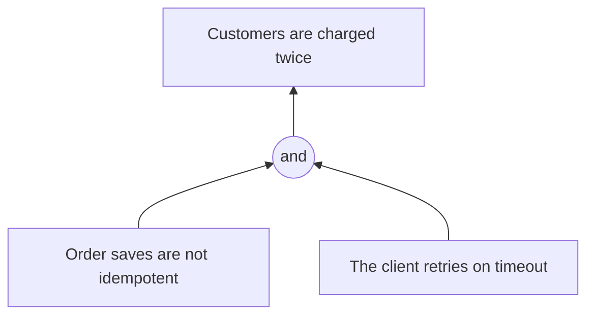

<!-- START doctoc generated TOC please keep comment here to allow auto update -->
<!-- DON'T EDIT THIS SECTION, INSTEAD RE-RUN doctoc TO UPDATE -->

- [The tools, as published](#the-tools-as-published)
  - [Two logics](#two-logics)
  - [The set of tools](#the-set-of-tools)
  - [Current Reality Tree](#current-reality-tree)
  - [What a root cause is](#what-a-root-cause-is)
  - [Drawing a tree](#drawing-a-tree)
  - [Evaporating Cloud](#evaporating-cloud)
  - [Future Reality Tree and Negative Branch Reservation](#future-reality-tree-and-negative-branch-reservation)
  - [Prerequisite Tree](#prerequisite-tree)
  - [Transition Tree](#transition-tree)

<!-- END doctoc generated TOC please keep comment here to allow auto update -->

# The tools, as published

The structure of each diagram. `sources.md` says where each source was read. TOCICO quotations are from the *TOCICO Dictionary*, second edition,
and Dettmer quotations from *The Logical Thinking Process* (2007).

## Two logics

TOCICO, *sufficiency-based logic*: "the existence of one or more causes leads unavoidably to the
existence of the effect." Read from the tail of the arrow: "If ... then ...". Causes needed together
are joined by "a logical 'and' connector (or ellipse)". The current reality tree, future reality tree,
negative branch reservation and transition tree use it.

TOCICO, *necessity-based logic*: "each entity at the tail of an arrow must exist in order for the
entity at the head of the arrow to exist." Read from the head: in order to have B we must have D. The
evaporating cloud and prerequisite tree use it, and "the validity of the connections is scrutinized by
questioning the validity of the assumptions underlying the relationship".

## The set of tools

Goldratt's original set was five trees for three questions (Dettmer, chapter 7). This skill uses the
original five and the negative branch reservation. TOCICO's strategy and tactics tree is outside its
procedure.

## Current Reality Tree

Two terms at the bottom of the tree, with UDE for undesirable effect:

- *root cause* (TOCICO): "An entity usually appearing at the lowest level of causality within a
  current reality tree for which there are no postulated causes." Several can exist.
- *core problem* (TOCICO): "generally one to three core problems will account for over 70% of the UDEs
  in an environment." If a root cause reaches "the majority of the UDEs including the most significant
  ones", it may be labeled the core problem. The 70% rule "is only a guideline", and Dettmer rejects it
  because the most serious UDEs may sit in the excluded 30% (chapter 4, "The '70 Percent' Criterion").

Loops: Dettmer, chapter 4: "eliminating the critical root cause that produces a negative reinforcing
loop is one of the most powerful changes for good that you can make."

## What a root cause is

In this method a root cause is the entity at the bottom of a branch where the tree builder had no
further cause to postulate. TOCICO distinguishes it from the TQM term, where a fishbone diagram yields
"the cause responsible for" a problem: a root cause here is "a state or condition over which a manager
has some degree of influence". The tree allows more than one root cause, and joins co-causes with
*and*.

Dettmer's second reason for giving up a single core problem: the wider the variety of UDEs, "the
broader the statement of a core problem is required to connect them", until it is "not discrete enough
to act upon" or reaches causes "well beyond the span of control" of a decision maker. He aims for "a few critical root causes that are both actionable and
within the sphere of influence of an accessible decision maker" (chapter 4, "Inability to Act on a Core
Problem" and "A Solution to the Core Problem Conundrum").

The critique of single root causes:

- Cook, *How Complex Systems Fail*, point 7 (online text, read 2026-11-11): "Post-accident attribution
  to a 'root cause' is fundamentally wrong."
- Allspaw, "Each necessary, but only jointly sufficient", Kitchen Soap, 2012-02-10 (blog post, read
  2026-11-11): "for complex systems: there is no root cause."
- Google, *Site Reliability Engineering*, chapter 15, "Postmortem Culture" (online text, read
  2026-11-11): a postmortem records "the root cause(s)", and "all contributing root cause(s)" are to be
  understood.

The skill's reading, not a published source: the *and* connector, separate arrows for independent
causes, and separate root causes when branches do not meet answer the critique. A root cause still
marks only where the builder stopped asking, and the checks test the links, not which facts entered the
tree. Read the facts from logs and history, not from the memory of the incident.

## Drawing a tree

The *if-then* sentences stay the primary form, because the links are read from them. A Mermaid diagram
can come in addition when the tree has more than a handful of entities. Effects go above causes, a
junction node stands for *and*, and causes that suffice alone point to the effect without a junction.

## Evaporating Cloud

TOCICO: "A cloud is composed of an objective A, two requirements (B and C) that must be met to achieve
A and two prerequisites (D and D') that express the conflict." Requirements are needs and
prerequisites are wants. The five arrows A-B, A-C, B-D, C-D' and D-D' carry the assumptions (TOCICO,
*three-cloud approach*). An injection is "a state, condition, or action that invalidates one or more
assumptions underlying the relationships". Dettmer, chapter 5: "All Arrows Are Fair Game."

## Future Reality Tree and Negative Branch Reservation

TOCICO, *future reality tree*: a sufficiency-based diagram that answers "To what to change?" by linking
proposed injections to desired effects (DEs), so that "the majority of the existing UDEs" are "replaced
by DEs" and "any new problems or UDEs" are found through the negative branch reservation process.

TOCICO, *negative branch reservation*: "An unintended negative consequence (i.e., new undesirable
effect) of a proposed problem solution or injection." "NBRs require a secondary or trimming injection
at the point where the tree branch starts turning negative".

## Prerequisite Tree

TOCICO: a necessity-based diagram that answers "how to cause the change?" by relating an injection, the
obstacles that block it and the intermediate objectives that overcome them. It "shows the sequence in
which the intermediate objectives must be achieved". An *obstacle* "blocks or prevents a desirable
system condition". An *intermediate objective* is "A transitional condition or milestone that must be
achieved before a main objective can be attained."

## Transition Tree

TOCICO: a sufficiency-based diagram that answers "how to cause the change?" with "a detailed,
step-by-step set of actions". Dettmer, chapter 7: "The repeating structure of the original TT had only
four elements" (existing reality, need, action, expected effect), and Goldratt added a fifth, the
rationale for the action. This skill keeps the five-element tree because a software change needs the
step-level plan.
